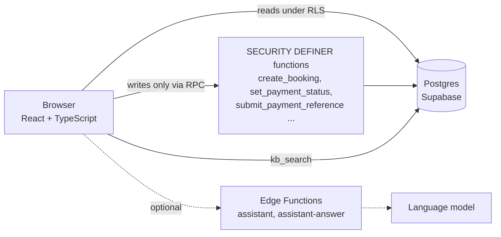

# Mashura (مشورة)

Arabic-first (RTL) consultation booking platform. Clients pick a consultation, pay by cash or wallet / InstaPay transfer, and get an invoice. A **chat assistant** answers their questions from a knowledge base and books for them from a sentence like *"عايز استشارة بكرة الساعة 5 العصر"*: it finds the slot, shows the server-computed price and books only after an explicit "yes".

**Live:** https://mashura-lemon.vercel.app

**Stack:** React 18 · TypeScript · Vite · React Router · Supabase (Auth, Postgres with Row Level Security, RPC functions, Edge Functions)

## Features

| Area | What it does |
|---|---|
| **Booking** | Consultation types, durations and modes (video / audio / in-person) from the database. Live open slots. The server computes the price and locks the slots in one transaction, so double booking and price tampering are impossible from the browser. |
| **Payments** | Cash at the session, or wallet / InstaPay transfer. The client sees the receiving details (set by the admin) with copy buttons, records the transfer reference, and staff confirm it. Confirmation, rejection and refunds notify the client; confirmed payments get a printable invoice. See [docs/PAYMENTS.md](docs/PAYMENTS.md). |
| **Assistant** | Understands Egyptian-Arabic dates and times, books after an explicit yes, and answers questions about booking, payment, cancellation and accounts by **retrieving** from a knowledge base (RAG). Optional language-model phrasing. See [docs/ASSISTANT.md](docs/ASSISTANT.md). |
| **Admin dashboard** | Bookings (confirm / cancel / complete / no-show, session link or location), payments to confirm, slot generation and blocking, consultation types and prices, clients, leads, notifications, the assistant's knowledge base, payment details, and team roles. |
| **Accounts** | Sign up / sign in / password reset, booking history, payment status, invoices, notifications. |
| **Security** | RLS on every table, writes only through validated `SECURITY DEFINER` functions, role-gated admin, security headers. See [SECURITY.md](SECURITY.md). |

Online card payments through a gateway are **not** integrated yet (see [Roadmap](#roadmap)).

## Architecture



More detail in [docs/ARCHITECTURE.md](docs/ARCHITECTURE.md).

## Run it locally

```bash
npm install
cp .env.local.example .env.local   # fill in your own Supabase URL + anon key
npm run dev                        # http://localhost:5173
```

### Supabase setup (the free plan is enough)

1. Create a project at [supabase.com](https://supabase.com).
2. In the **SQL editor** run, in this order:
   `supabase/migrations/0001_init.sql` → `0002_security_hardening.sql` → `supabase/seed.sql` → `supabase/migrations/0003_payments_and_knowledge.sql` → `supabase/seed_kb.sql`.
   (`seed.sql` also generates four weeks of slots.)
3. Put the project URL and the **publishable / anon** key in `.env.local`. Never use the secret / service_role key in the frontend.
4. Sign up in the app, then make yourself the owner:
   ```sql
   update public.profiles set role = 'owner' where email = 'you@example.com';
   ```
   `/admin` now opens for you. Roles cannot be changed from the browser by design.
5. In the admin dashboard → **Payments**, fill in your wallet number / InstaPay address.
6. Recommended Auth settings: minimum password length 8, CAPTCHA, your site URL and `<site>/reset`, `<site>/app` in the redirect allow-list, and a custom SMTP provider (Supabase's built-in mailer is limited to a couple of emails per hour).

### Optional: sample activity

For a dashboard with realistic history (8 sample clients, ~24 bookings with payments in every state, leads), run `supabase/seed-sample-data.sql`. Remove it any time with `supabase/remove-sample-data.sql`. Sample rows are marked (`@sample.mashura.test`, refs `MSH-S…`) so real data is never touched.

### Optional: language-model mode for the assistant

The parser and the knowledge-base search work without any API. To let a model help with unusual phrasing and phrase answers from the retrieved articles:

```bash
supabase functions deploy assistant
supabase functions deploy assistant-answer
supabase secrets set GROQ_API_KEY=...        # stored in Supabase, never in the repo
# then set VITE_ASSISTANT_AI=true in the frontend env
```

## Tests

```bash
npm test
```

Runs against an in-process Postgres ([PGlite](https://pglite.dev)), no Supabase project needed:

| Suite | Covers |
|---|---|
| `tests/db/security.test.mjs` | 58 attack cases: privilege escalation, direct table writes, price tampering, double booking, IDOR, invalid transitions, malformed input |
| `tests/db/payments-kb.test.mjs` | Transfer reference flow, who can confirm, notifications, settings RLS, Arabic knowledge-base search |
| `tests/db/sample-data.test.mjs` | Sample data loads idempotently and removes cleanly |
| `tests/assistant/assistant.test.mjs` | Assistant engine end to end with the real search SQL: booking is never hijacked by questions, outages degrade gracefully |

CI runs type-check, tests and the production build on every push.

## Deploy (Vercel)

Import the repo, set `VITE_SUPABASE_URL` and `VITE_SUPABASE_ANON_KEY`, deploy. `vercel.json` adds security headers (CSP, frame blocking, HSTS) and the SPA rewrite.

## Project layout

```
src/lib/assistantNlu.ts       Egyptian-Arabic parser (dates, times, durations, intents)
src/lib/assistantEngine.ts    conversation engine + knowledge-base answers (dependencies injected)
src/components/               Assistant widget, PaymentInstructions, icons
src/lib/api.ts                typed Supabase / RPC client with Arabic error messages
src/lib/invoice.ts            printable invoice
src/pages/                    landing, auth, client app, admin app
supabase/migrations/          schema, RLS, RPC functions, payments and knowledge base
supabase/seed*.sql            starter data, knowledge-base articles, optional sample activity
supabase/functions/           optional Edge Functions (assistant, assistant-answer)
tests/                        database security, payments, assistant
docs/                         architecture, payments, assistant (RAG)
```

## Roadmap

- Card payments through a local gateway (e.g. Paymob) with server-side webhooks marking payments paid.
- Email / WhatsApp reminders before sessions.
- Reports (revenue by month, busiest hours).

## License

[MIT](LICENSE)

---

## بالعربي

**مشورة** منصة حجز استشارات بالعربي. العميل يختار الاستشارة والميعاد، يدفع كاش أو بتحويل على محفظة / إنستا باي ويكتب رقم العملية، والفريق يأكّد الدفع فتوصله فاتورة. فيها مساعد ذكي بيجاوب أسئلة العملاء من قاعدة معرفة (أسئلة وأجوبة بتتعدّل من لوحة الإدارة)، وبيحجز من جملة زي «عايز استشارة بكرة الساعة ٥ العصر» وما بيسجل الحجز غير بعد ما العميل يقول «أيوه».

- الحجز والسعر والمواعيد بيتحسبوا ويتأمّنوا على السيرفر، فمفيش طريقة لتغيير السعر أو حجز نفس الميعاد مرتين من المتصفح.
- لوحة الإدارة: الحجوزات، التحويلات اللي مستنية تأكيد، المواعيد، الأنواع والأسعار، العملاء، أسئلة المساعد، وبيانات الدفع والفريق.
- خطوات التشغيل فوق، وأوامر الاختبار `npm test`، وملف [SECURITY.md](SECURITY.md) بيشرح الحماية.
- الدفع بالكارت البنكي عن طريق بوابة دفع لسه مش متوصّل (موجود في خطة التطوير).
